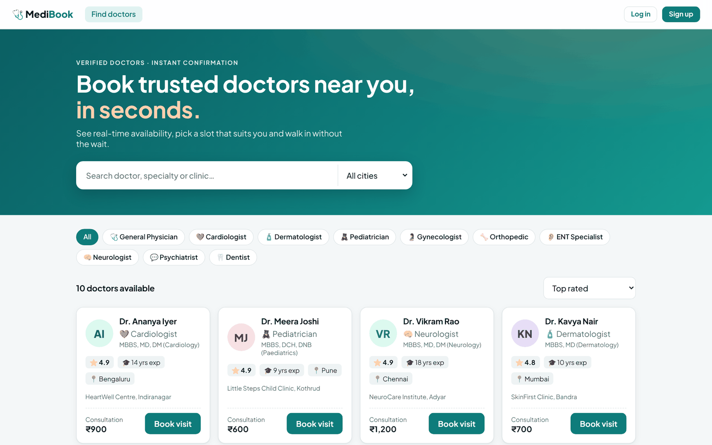
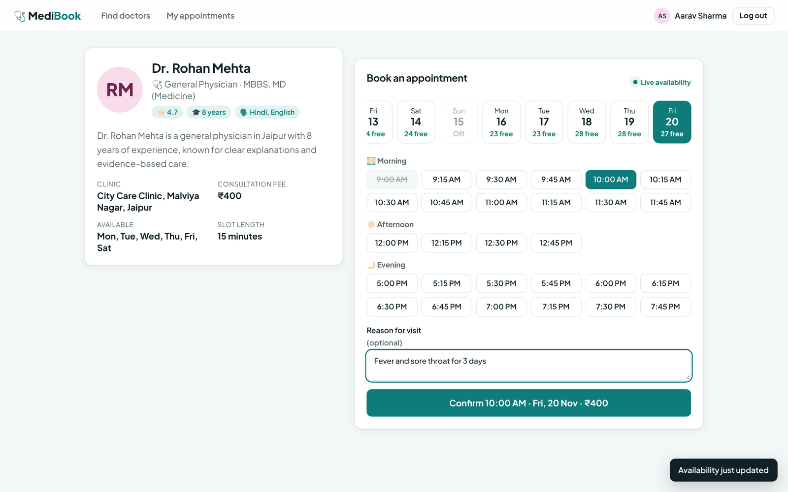
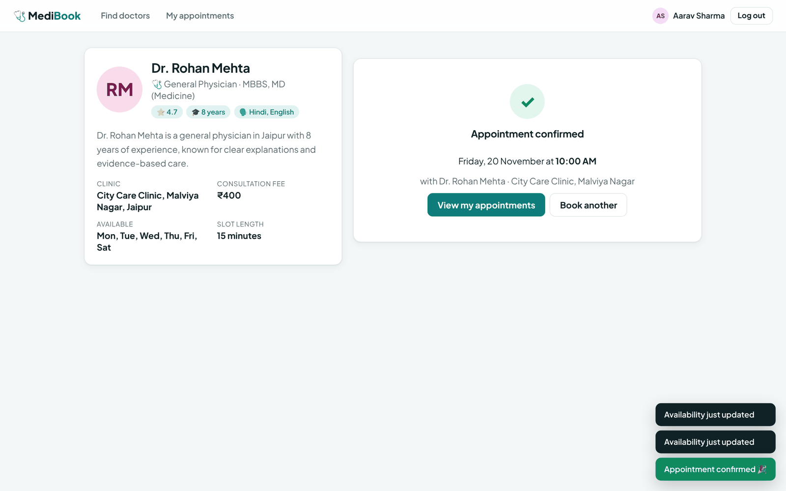
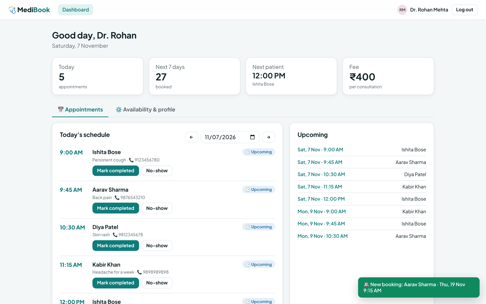
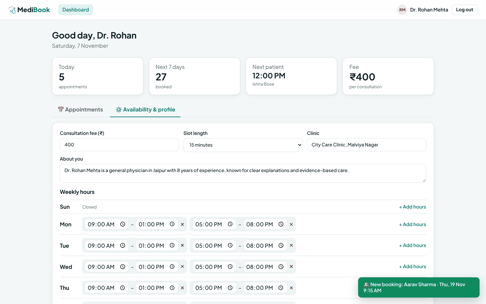
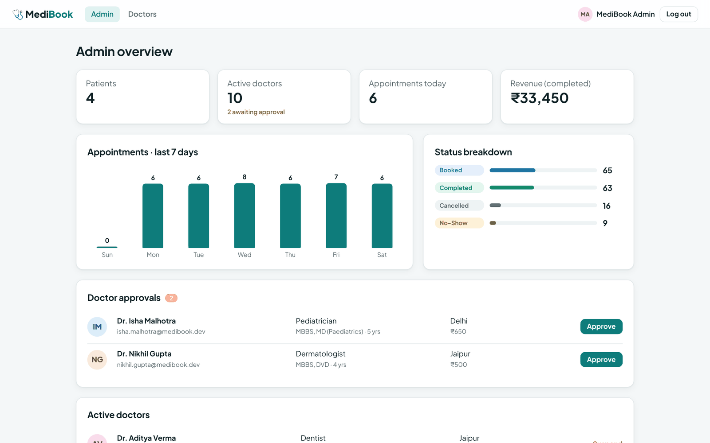
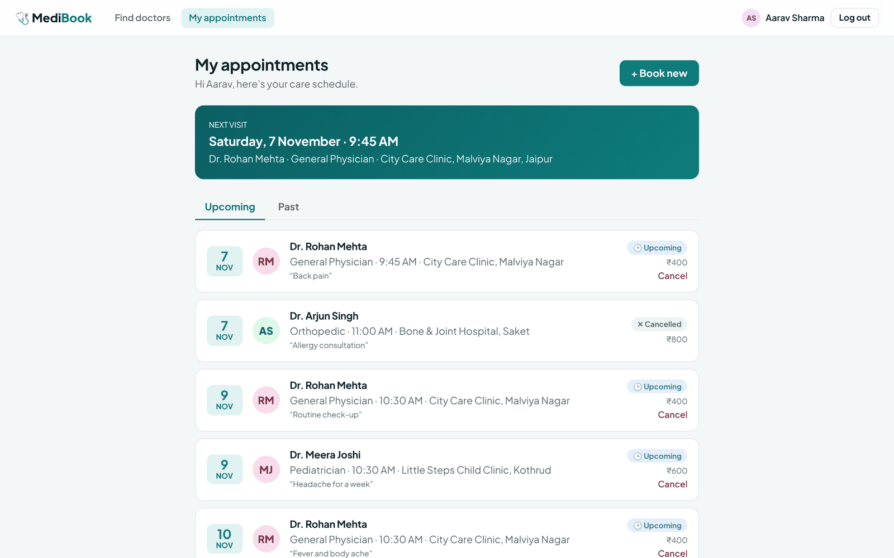
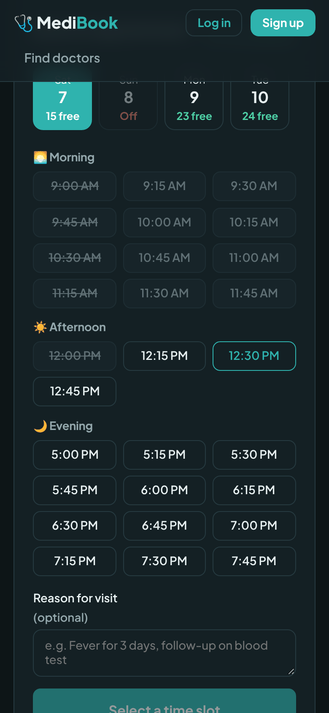

<div align="center">

# 🩺 MediBook

### Doctor appointment booking platform — real-time availability, three user roles, zero double bookings

[](https://github.com/umeshgoingtohienght/medibook/actions/workflows/ci.yml)


[](https://YOUR-MEDIBOOK-APP.vercel.app)



</div>

---

## 💡 The problem

Booking a doctor in India often means phone calls, long waiting rooms and clinics that over-book. MediBook lets patients **see live availability and book a confirmed slot in seconds**, gives doctors a clean daily schedule, and lets an admin verify every doctor before they go live.

## 👥 Three roles

| 🙋 Patient | 🩺 Doctor | 🛡️ Admin |
|---|---|---|
| Search doctors by specialty, city or name | Daily schedule with patient details | Platform stats & 7-day activity |
| See free slots for the next 14 days | Mark visits completed / no-show | Approve or suspend doctors |
| Book, view and cancel appointments | Edit weekly hours, slot length & fee | Appointment status breakdown |
| Live notifications when the doctor updates a visit | **Instant notification** of new bookings | Revenue from completed visits |

## ✨ Engineering highlights

- 🔒 **Race-condition-proof booking** — a unique `slotKey` index (`doctor|date|time`) makes MongoDB reject the second of two simultaneous bookings atomically; cancelling renames the key to free the slot. Covered by a test that fires two bookings at the same instant.
- ⚡ **Real-time updates with Socket.io** — everyone viewing a doctor sees a slot disappear the moment someone books it; doctors get a toast for every new booking; JWT-authenticated private rooms for personal notifications.
- 🕒 **Pure, tested slot engine** — generates slots from weekly schedules (multiple blocks per day), works in IST regardless of server timezone, enforces a 30-day booking window and hides slots starting within 15 minutes.
- 🛡️ **Role-based access control** — `authorize("doctor", "admin")` middleware, ownership checks on every appointment (a stranger gets 404, not 403, so IDs can't be probed).
- 📏 **Business rules** — one active booking per patient per doctor per day, doctors can't complete future visits, past visits can't be cancelled, doctors need admin approval.
- 🔐 **Security** — bcrypt (12 rounds), Helmet, CORS allow-list, rate-limited auth, body-size limits, mass-assignment protection.
- ✅ **28 automated tests** — slot engine unit tests + API integration tests (auth, RBAC, search, booking, concurrency, cancellation, sockets, admin) on GitHub Actions with a real MongoDB.

## 📸 Screenshots

| Live slot booking | Booking confirmed |
|:---:|:---:|
|  |  |

| Doctor dashboard (live booking alert) | Weekly availability editor |
|:---:|:---:|
|  |  |

| Admin dashboard | Patient appointments | Mobile · dark mode |
|:---:|:---:|:---:|
|  |  |  |

## 🏗️ Architecture

```
┌───────────────────────────┐   REST (JWT)    ┌─────────────────────────────────┐      ┌──────────┐
│ React + Vite              │ ──────────────▶ │ Express API                      │ ───▶ │ MongoDB  │
│ Auth · Socket · Toast ctx │ ◀────────────── │ routes → RBAC → controllers      │      │ Mongoose │
│ Patient/Doctor/Admin UIs  │                 │ slot engine (pure functions)     │      └──────────┘
└────────────┬──────────────┘                 └───────────────┬─────────────────┘
             │        WebSocket  slots:changed · appointment:new │
             └──────────────────── Socket.io ◀──────────────────┘
```

## 🔌 API

| Method | Endpoint | Role | Description |
|---|---|---|---|
| `POST` | `/api/auth/register` | — | Patient or doctor sign-up (doctors start as pending) |
| `POST` | `/api/auth/login` | — | Returns JWT + role |
| `GET` | `/api/doctors` | — | Search: `specialty`, `city`, `search`, `sort` |
| `GET` | `/api/doctors/:id/availability` | — | Free slots per day (14 days) |
| `GET` | `/api/doctors/:id/slots?date=` | — | Slots with availability for a date |
| `PATCH` | `/api/doctors/me/profile` | doctor | Update hours, fee, slot length, bio |
| `POST` | `/api/appointments` | patient | Book a slot |
| `GET` | `/api/appointments` | any | Own appointments (`scope`, `date`) |
| `PATCH` | `/api/appointments/:id/cancel` | owner | Cancel and free the slot |
| `PATCH` | `/api/appointments/:id/status` | doctor | `completed` / `no-show` |
| `GET` | `/api/admin/stats` | admin | Dashboard numbers |
| `PATCH` | `/api/admin/doctors/:id` | admin | Approve / suspend a doctor |

## ⚡ Getting started

**Prerequisites:** Node.js 18+ and MongoDB (local or a free [Atlas](https://www.mongodb.com/atlas) cluster).

```bash
git clone https://github.com/umeshgoingtohienght/medibook.git
cd medibook

# API
cd server
cp .env.example .env          # set MONGO_URI and JWT_SECRET
npm install
npm run seed                  # demo doctors, patients & appointments
npm run dev                   # http://localhost:5000

# Frontend (new terminal)
cd client
npm install
npm run dev                   # http://localhost:5173
```

**Demo accounts** (also one click away on the login page):

| Role | Email | Password |
|---|---|---|
| Patient | `patient@medibook.dev` | `Patient@123` |
| Doctor | `rohan.mehta@medibook.dev` | `Doctor@123` |
| Admin | `admin@medibook.dev` | `Admin@123` |

**Tests:** `cd server && npm test` (uses an in-memory MongoDB automatically).

> 💡 Try real-time: open a doctor's page in two browser windows logged in as different patients, book a slot in one — it disappears in the other instantly.

## 🛣️ Roadmap

- [ ] Online payments (Razorpay) and invoices
- [ ] Email / WhatsApp reminders the day before
- [ ] Video consultations
- [ ] Patient reviews that update doctor ratings

## ⚠️ Disclaimer

All doctors, clinics and patients in the seed data are fictional.

## 📜 License

[MIT](LICENSE)

---

<div align="center">Made with ❤️ by <a href="https://github.com/umeshgoingtohienght">Umesh Meena</a> · ⭐ Star this repo if you like it!</div>
